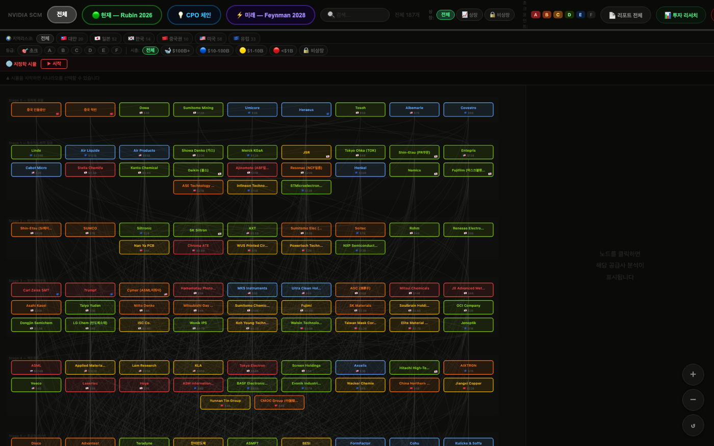
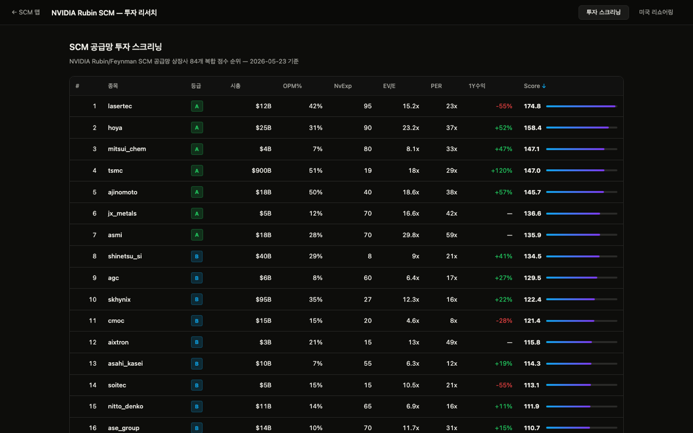

# NVIDIA Rubin / Feynman 공급망 리스크 분석

NVIDIA 차세대 AI 가속기(Vera Rubin, Feynman)의 공급망을 노드 138개짜리 지도로 정리하고, 특정 지역이나 기업이 멈췄을 때 충격이 어디까지 번지는지 계산하는 시뮬레이터를 만든 분석 프로젝트입니다.

**[라이브 데모](https://nvidia-scm-analysis.vercel.app)** · [투자 리서치 페이지](https://nvidia-scm-analysis.vercel.app/research.html) · [리서치 문서](docs/)



## 한눈에 보기

| 항목 | 내용 |
| --- | --- |
| 기간 | 2026년 5월 ~ 6월 |
| 주제 | 반도체 공급망 구조와 지정학 리스크 |
| 한 일 | 공개 자료 조사, 공급망 데이터 모델링, 리스크 시뮬레이터 구현, 리서치 문서 작성 |
| 도구 | Python(데이터 생성·빌드), JavaScript(시뮬레이터·시각화), Web Worker |
| 규모 | 노드 138개, 공급 흐름 52개, 충격 시나리오 6개, 상장사 84곳 스크리닝 |

## 어떤 질문에서 시작했나

AI 가속기 한 대가 나오려면 소재, 장비, 파운드리, 메모리, 패키징, 광부품 회사가 순서대로 맞물려야 합니다. 뉴스는 "대만 리스크"처럼 한 단어로 말하지만, 실제로 어느 회사가 멈추면 어디까지 영향이 가는지는 공급 관계를 따라가 봐야 알 수 있습니다. 그래서 다음 세 가지를 직접 확인해 보려고 했습니다.

1. 공급망의 어느 지점이 대체하기 어려운 단일 실패 지점인가
2. 대만해협 분쟁이나 수출 통제 같은 사건이 나면 NVIDIA 출하에 얼마나, 얼마나 빨리 영향이 가는가
3. 미국의 보조금·관세·수출통제가 공급망 기업들의 위치를 어떻게 바꾸는가

## 한 일

### 1. 공급망 지도

소재 → 장비 → 웨이퍼·파운드리 → 메모리(HBM) → 패키징(CoWoS) → 광인터커넥트(CPO) → 시스템 순서로, 기업을 노드로 공급 관계를 흐름으로 정리했습니다. 노드마다 국가, 시장 점유율, 대체 공급처 전환에 걸리는 기간, 출처 등급을 붙였습니다. 현재 세대(Rubin, 2026)와 다음 세대(Feynman, 2028~)를 나눠 볼 수 있습니다.

### 2. 리스크 전파 시뮬레이터

노드 하나나 지역 전체를 차단하면 공급 관계를 따라 하류 노드의 공급 손실을 계산합니다.

- 위상 정렬 순서로 상류에서 하류로 손실을 전파합니다.
- 대체 공급처 비중과 재고 버퍼를 반영합니다.
- 몬테카를로로 여러 번 돌려 결과 분포를 히스토그램으로 보여 줍니다. 지역 간 동시 발생은 가우시안 코풀라로 상관을 줍니다.
- 계산은 Web Worker에서 돌려 화면이 멈추지 않습니다. 서버 없이 브라우저만으로 동작합니다.

### 3. 충격 시나리오 6개

| 시나리오 | 내용 |
| --- | --- |
| 대만해협 분쟁 | TSMC 가동 중단, 첨단 로직 공급 차단 |
| 중국 인듐 수출 금지 | 인듐 공급의 약 70% 차단, InP 기판 체인 마비 |
| 중국 적린 수출 통제 | 적린 공급의 약 80% 차단, InP 합성 중단 |
| AIXTRON 단일공급 충격 | MOCVD 장비 한 곳에 광부품 3사가 동시에 의존 |
| 일본 소재·장비 수출 통제 | ABF, EUV 포토레지스트, 실리콘 웨이퍼 동시 차질 |
| 남중국해 봉쇄 | 대만·일본·한국 부품 운송 차질 |

### 4. 단일 실패 지점 순위

차단했을 때 NVIDIA까지 영향이 얼마나 빨리, 직접 도달하는지를 기준으로 노드 중심성을 계산해 병목 순위를 뽑았습니다.

### 5. 상장사 스크리닝과 리서치 문서

공급망에 속한 상장사 84곳을 초크포인트 등급(독점 정도), 영업이익률, NVIDIA 매출 의존도, 공급사 전환에 걸리는 기간, 밸류에이션(EV/EBITDA)으로 점수화했습니다. 이어서 미국의 통제력이 미치는 정도(US Control Score)를 기준으로 기업을 다시 분류했습니다.



| 문서 | 내용 |
| --- | --- |
| [docs/INVEST_DEEPDIVE.md](docs/INVEST_DEEPDIVE.md) | 스크리닝 방법, 상위 30곳, 테마별 분류, 4개 종목 상세 |
| [docs/GEO_RESHORE_ANALYSIS.md](docs/GEO_RESHORE_ANALYSIS.md) | 미국 중심 공급망 재편과 기업별 위치 |
| [docs/US_CONTROL_SCM_ANALYSIS.md](docs/US_CONTROL_SCM_ANALYSIS.md) | 보조금·관세·수출통제가 만드는 레버리지 |

## 직접 실행

브라우저에서 `index.html`을 열면 됩니다. 서버가 필요 없습니다.

```bash
node tests/test_risk_sim.js   # 시뮬레이터 단위 테스트 8개
```

## 파일 구성

| 파일 | 역할 |
| --- | --- |
| `index.html` | 공급망 분석 리포트와 리스크 시뮬레이터 |
| `scm_full.html` | 전체 공급망 지도 |
| `research.html` | 상장사 스크리닝·투자 리서치 페이지 |
| `risk_sim.js`, `risk_worker.js` | 리스크 전파 엔진과 몬테카를로 Web Worker |
| `scm_nodes.json`, `nodes_full.json`, `flows.js`, `layout.json` | 노드·흐름·배치 데이터 |
| `risk_data.json`, `marketcaps.json` | 시나리오 입력값, 공개 시가총액 |
| `scm_data.py`, `gen_*.py`, `build_data.py`, `patch_html.py` | 데이터 생성과 HTML 빌드 스크립트 |
| `tests/test_risk_sim.js` | 시뮬레이터 단위 테스트 |

`build_data.py`는 원본 리서치 마크다운을 읽어 HTML을 다시 만듭니다. 원본 위치는 `SCM_SOURCE_DIR` 환경변수로 지정하며, 원본 마크다운은 이 저장소에 없습니다.

## 배운 점과 한계

- **구조를 그려야 보이는 것이 있었습니다.** 표면에서는 한 줄인 공급 관계가, 따라가 보면 원료·기판·장비·전구체 가스까지 여러 층으로 깊어집니다. 병목은 유명한 대기업보다 그 아래 층의 작은 회사에 있는 경우가 많았습니다.
- **수치는 2026년 5월 공개 자료 기준입니다.** 기업 공시, 업계 보고서, 언론 보도를 썼고 수치마다 출처 등급을 표기했습니다.
- **시뮬레이션 입력은 가정입니다.** 대체 공급 비중, 재고 버퍼, 지역 간 상관계수는 공개 자료로 추정한 값이라, 결과는 정확한 예측이 아니라 상대적인 크기 비교로 봐야 합니다.
- **투자 리서치 문서는 공급망 분석의 연장선에서 정리한 개인 연구 기록입니다.** 특정 종목의 매수·매도 권유가 아닙니다.
